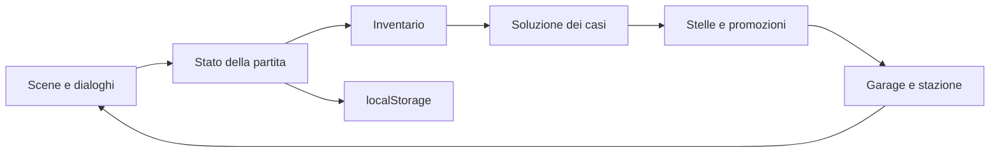

# Agente Pippo e i misteri di Porto Buffo

Avventura web originale punta e clicca in italiano, per bambini dai 6 anni. Umorismo, inventario e dialoghi ispirati alle avventure classiche. Sei missioni senza combattimenti, timer o penalità. Grafica CSS e personaggi emoji; prima versione giocabile.

Aprire `dist/index.html` in un browser moderno. Nessuna installazione necessaria. Per ascoltare i dialoghi attivare la voce e premere il pulsante altoparlante; la disponibilità delle voci italiane dipende dal browser. Toccare un oggetto per raccoglierlo, selezionarlo nello zainetto e toccare il personaggio per usarlo. Ogni caso richiede un dialogo e l'ispezione di un indizio.

Ogni missione assegna 5 stelle. Mezzi e reparti costano 2 stelle ciascuno. Per continuare occorre acquistare entrambi: bicicletta, moto, auto, auto sportiva, camion, elicottero. I progressi sono salvati nel browser su questo dispositivo. Non vengono raccolti nomi o dati personali. Il reset richiede conferma.

Verifica: `node scripts/game_test.cjs` e `node --check dist/game.js`.

Struttura: `dist/` sito pubblicabile; `scripts/` test; `docs/` contratto e verifiche; `artifacts/` pacchetti e report. Nessuna dipendenza JavaScript. Font Google opzionali con fallback locali. Nessun codice Python o nuova CLI applicativa.

Conformità R66: L1 locale, implementazione e verifiche mirate; documentazione e dati coerenti; protezione da ricompense duplicate; limiti di verifica registrati in `docs/task.md`. Nessuna modifica infrastrutturale QwenPaw.
