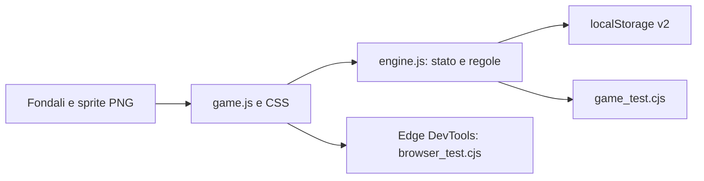

# Agente Pippo — Il segreto di Porto Buffo

Avventura web originale in italiano e inglese per bambini dai 6 anni. Estetica di avventura cartoon classica, sei fondali illustrati, personaggio animato ispirato alla reference dell’utente, dialoghi comici e storia collegata del Barone Sottosopra. Nessun combattimento, timer, penalità o acquisto reale.

Revisione grafica: fondali e personaggi rifiniti, sei veicoli e trenta oggetti illustrati, anteprime dei reparti. Lettura italiana con priorità alle voci naturali del dispositivo, tono per personaggio e pause tra frasi; il pulsante di ascolto funziona anche quando la lettura automatica è disattivata.

Repository: https://github.com/albertogiacomel/AgentPippo . **Per riprendere nei prossimi giorni leggere [docs/resume.md](docs/resume.md)**: stato, preferenze, mappa del codice, verifiche e limiti.

## Avvio e hosting

Richiede Node.js 22 o successivo per gli strumenti. Wrangler è una dipendenza di sviluppo per il backend Cloudflare; il gioco nel browser non richiede librerie esterne.

```sh
git clone https://github.com/albertogiacomel/AgentPippo.git
cd AgentPippo
npm ci
npm run build
npm test
npm run dev
```

Aprire http://127.0.0.1:3000 . Su Windows con Edge, `npm run test:browser` verifica anche la campagna reale.

**Vercel:** importare il repository; `vercel.json` configura framework Other, build `npm run build`, output `dist`.

**Cloudflare Pages:** collegare il repository; framework None, build `npm run build`, output `dist`, branch `main`. Dettagli e limiti dei salvataggi in [docs/deployment.md](docs/deployment.md).

GitHub Actions verifica build e motore a ogni push e pull request. Non include il test Edge specifico per Windows.

Ogni push su **main** pubblica automaticamente il gioco e il backend su Cloudflare, dopo il passaggio dei test. Le pull request verificano il codice senza pubblicare. Il workflow controlla anche le API della versione pubblicata.

Backend Cloudflare gratuito preparato: **Salvataggi** permette copie cloud e ripresa con codice, quando D1 è configurato. Guida e stato attivazione in [docs/cloud_backend.md](docs/cloud_backend.md). `npm run test:cloud` verifica API e database nel runtime Cloudflare locale; la CI esegue anche questa verifica.

## Giocare

Sito: https://agentpippo.giacomel.info (Cloudflare: https://agent-pippo.pages.dev). Presentazione in https://giacomel.info/#hobbies, sezione Experiments. Copia Sites precedente: https://agente-pippo-porto-buffo.brownauk3.chatgpt.site (accesso privato del proprietario). In locale aprire `dist/index.html`: nessun build, installazione o server necessario per il gioco offline.

Il pulsante **EN / IT** e il selettore in **Impostazioni** cambiano lingua immediatamente, senza ricaricare la pagina: dialoghi, enigmi, inventario, garage e menu aperti si aggiornano mantenendo i progressi. **Impostazioni** contiene lingua, effetti sonori, lettura dei dialoghi e difficoltà: Guidata offre aiuti espliciti e conserva le note corrette; Normale usa suggerimenti progressivi; Sfida riduce gli indizi e offre solo il suggerimento iniziale. Le preferenze restano su questo dispositivo e sono separate dai salvataggi cloud. Su Windows la campagna inglese si verifica impostando `PIPPO_LANGUAGE=en` prima di `npm run test:browser`. Architettura e manutenzione: [docs/localization.md](docs/localization.md).

- **Guarda**: osserva oggetti e registra gli indizi nel diario.
- **Parla**: apre dialoghi con risposte selezionabili.
- **Prendi**: raccoglie un oggetto nella scena.
- **Usa**: seleziona un oggetto nelle tasche e tocca un bersaglio nella scena. Senza oggetto selezionato attiva organetto e macchina dei pacchi.
- **Combina**: seleziona due oggetti diversi nelle tasche.
- Le frecce nella scena collegano due luoghi per ogni capitolo. Il diario raccoglie obiettivo e indizi. L’aiuto offre prima un suggerimento, poi un indizio, infine la soluzione.

La voce legge dialoghi ed enigmi in italiano. Le note dell’organetto hanno frequenze distinte; i simboli rendono il puzzle utilizzabile anche senza audio. La disponibilità della voce italiana dipende dal dispositivo.

## Sei enigmi diversi

| Capitolo | Meccanica |
|---|---|
| La ricetta sotto chiave | Indovinello con tre risposte e uso della chiave |
| La serenata del ladro | Spartito visuale e sequenza sonora di quattro note |
| Il gelato che non voleva sciogliersi | Miscela di colori riutilizzabili |
| Tre maschere, una corona | Deduzione incrociando guanti e impronte |
| La posta tutta sottosopra | Riordino dei pacchi dal piccolo al grande |
| Il Barone e la nuvola testarda | Telo + corda, indovinello e direzione del vento |

Ogni caso assegna 5 stelle una sola volta. Mezzi e reparti costano 2 stelle ciascuno. Per proseguire occorre comprare entrambi: bicicletta, moto, auto, auto sportiva, camion, elicottero. Le risposte sbagliate non consumano stelle o oggetti essenziali.

## Salvataggi

`porto_buffo_v2` in localStorage, sul dispositivo e browser corrente. I salvataggi v1 vengono migrati preservando promozioni, stelle, mezzi e capitoli completati; il puzzle del capitolo corrente riparte se non era risolto. Per rigiocare tutti i nuovi enigmi scegliere **Nuova partita**, con conferma esplicita. Nessun nome o dato personale richiesto. Lo storage non viene sincronizzato tra dispositivi.

## Architettura e verifiche

Garage operativo: ogni mezzo acquistato si può selezionare gratuitamente, viene salvato e appare nella scena e negli spostamenti. Bicicletta con campanello, moto con faro, pattuglia con lampeggianti, sportiva con partenza rapida, camion per le consegne e elicottero per raggiungere il faro. L’avanzamento richiede un mezzo adeguato al prossimo caso. I salvataggi precedenti mantengono progressi, stelle e acquisti e selezionano il mezzo più recente.

Tutti i reparti costruiti restano accessibili: ufficio con fascicolo e partenze, radio che riproduce lo spartito trovato, laboratorio per mescolare le bottiglie raccolte, archivio per confrontare i due indizi, officina per ordinare e consegnare i pacchi, centro operativo con costruzione dell’aquilone e radar. Gli strumenti agiscono sullo stesso stato degli enigmi nelle scene: nessuna duplicazione di ricompense o reset dei pacchi cambiando veicolo.



- `node --check dist/engine.js`
- `node --check dist/game.js`
- `node scripts/game_test.cjs`
- `node scripts/browser_test.cjs` (Windows con Edge; avvia HTTP e browser propri, li chiude a fine test).

Il test browser gioca tutti i sei capitoli con l’interfaccia reale, prova errori e blocchi, ricarica i progressi, annulla il reset e verifica il layout a 390 px. Screenshot e report sono in `artifacts/`, esclusi da Git. Non ci sono dipendenze JavaScript esterne, font remoti o nuove CLI applicative. Gli script sono test runner, non CLI con parsing di parametri.

Struttura: `dist/` sito; `scripts/` test; `docs/` contratto e asset; `artifacts/` report e pacchetti. Conformità R66: modifica L1 isolata, test negativi e runtime, documentazione allineata, migrazione dati e prevenzione dei blocchi. Limiti NAS in `docs/task.md`. Provenienza e prompt asset in `docs/assets.md`.
