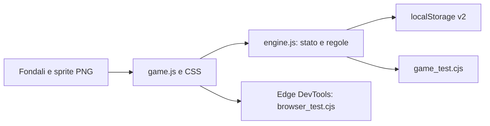

# Agente Pippo — Il segreto di Porto Buffo

Avventura web originale in italiano per bambini dai 6 anni. Estetica di avventura cartoon classica, sei fondali illustrati, personaggio animato ispirato alla reference dell’utente, dialoghi comici e storia collegata del Barone Sottosopra. Nessun combattimento, timer, penalità o acquisto reale.

## Giocare

Sito: https://agente-pippo-porto-buffo.brownauk3.chatgpt.site (accesso privato del proprietario). In locale aprire `dist/index.html`: nessun build, installazione o server necessario.

- **Guarda**: osserva oggetti e registra gli indizi nel diario.
- **Parla**: apre dialoghi con risposte selezionabili.
- **Prendi**: raccoglie un oggetto nella scena.
- **Usa**: seleziona un oggetto nelle tasche e tocca un bersaglio nella scena. Senza oggetto selezionato attiva organetto e macchina dei pacchi.
- **Combina**: seleziona due oggetti diversi nelle tasche.
- Le frecce nella scena collegano due luoghi per ogni capitolo. Il diario raccoglie obiettivo e indizi. L’aiuto offre prima un suggerimento, poi un indizio, infine la soluzione.

La voce legge dialoghi ed enigmi in italiano. Le note dell’organetto hanno frequenze distinte; i simboli rendono il puzzle utilizzabile anche senza audio. La disponibilità della voce italiana dipende dal dispositivo.

## Sei enigmi diversi

| Capitolo | Meccanica |
|---|---|
| La ricetta sotto chiave | Indovinello con tre risposte e uso della chiave |
| La serenata del ladro | Spartito visuale e sequenza sonora di quattro note |
| Il gelato che non voleva sciogliersi | Miscela di colori riutilizzabili |
| Tre maschere, una corona | Deduzione incrociando guanti e impronte |
| La posta tutta sottosopra | Riordino dei pacchi dal piccolo al grande |
| Il Barone e la nuvola testarda | Telo + corda, indovinello e direzione del vento |

Ogni caso assegna 5 stelle una sola volta. Mezzi e reparti costano 2 stelle ciascuno. Per proseguire occorre comprare entrambi: bicicletta, moto, auto, auto sportiva, camion, elicottero. Le risposte sbagliate non consumano stelle o oggetti essenziali.

## Salvataggi

`porto_buffo_v2` in localStorage, sul dispositivo e browser corrente. I salvataggi v1 vengono migrati preservando promozioni, stelle, mezzi e capitoli completati; il puzzle del capitolo corrente riparte se non era risolto. Per rigiocare tutti i nuovi enigmi scegliere **Nuova partita**, con conferma esplicita. Nessun nome o dato personale richiesto. Lo storage non viene sincronizzato tra dispositivi.

## Architettura e verifiche

- `node --check dist/engine.js`
- `node --check dist/game.js`
- `node scripts/game_test.cjs`
- `node scripts/browser_test.cjs` (Windows con Edge; avvia HTTP e browser propri, li chiude a fine test).

Il test browser gioca tutti i sei capitoli con l’interfaccia reale, prova errori e blocchi, ricarica i progressi, annulla il reset e verifica il layout a 390 px. Screenshot e report sono in `artifacts/`, esclusi da Git. Non ci sono dipendenze JavaScript esterne, font remoti o nuove CLI applicative. Gli script sono test runner, non CLI con parsing di parametri.

Struttura: `dist/` sito; `scripts/` test; `docs/` contratto e asset; `artifacts/` report e pacchetti. Conformità R66: modifica L1 isolata, test negativi e runtime, documentazione allineata, migrazione dati e prevenzione dei blocchi. Limiti NAS in `docs/task.md`. Provenienza e prompt asset in `docs/assets.md`.
