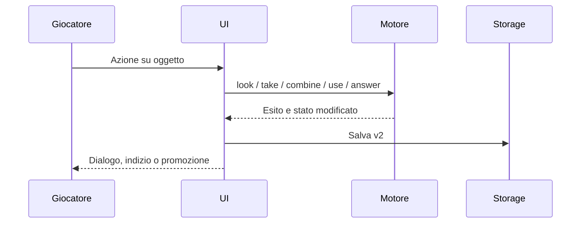

# 1. Obiettivi

Avventura autonoma per bambini di 6 anni: leggere/ascoltare, esplorare, ragionare, progredire senza penalità.

# 2. Vincoli

Sito statico, nessuna dipendenza runtime, touch e tastiera, voci native del browser, nessun dato personale.

# 3. Contesto

Giocatore e browser locale; hosting Sites privato. Nessuna integrazione con KB o servizi NAS.

# 4. Strategia

Regole pure separate dal DOM. Contenuti di capitoli e oggetti guidati dai dati; enigmi con transizioni specifiche. Decisione in [ADR 0001](adr/0001_engine_ui.md).

# 5. Componenti

`engine.js`: stato, capitoli, inventario, soluzioni, carriera. `game.js`: DOM, dialoghi, voce, input, persistenza. CSS e atlas PNG: resa. Test Node ed Edge: verifica.

# 6. Runtime

# 7. Deployment

Sites serve `dist/`. Il helper salva sorgenti e commit, prepara archivio e pubblica mantenendo l'accesso privato.

# 8. Concetti trasversali

localStorage versionato e validato; migrazione v1; ricompensa idempotente; bottiglie riutilizzabili; reset confermato; fallback testuale per voce; preferenze di movimento ridotto rispettate.

# 9. Decisioni

[ADR 0001](adr/0001_engine_ui.md): separazione motore e interfaccia senza framework.

# 10. Qualità

Scenario: risposta sbagliata → nessuna perdita di stelle o materiale essenziale. Reload → stessa carriera. Width 390 px → nessun overflow. Test browser → sei casi risolti tramite controlli reali, zero eccezioni JS e asset mancanti.

# 11. Rischi

Voce e resa font dipendono dal dispositivo. localStorage non sincronizzato. Sprite generate hanno proporzioni non perfettamente uniformi. Nessun server multiplayer o account del bambino.

# 12. Glossario

Capitolo: missione con meccanica propria. Luogo: pannello esplorabile del fondale. Flag: indizio o progresso verificato. Atlas: immagine con più scene/pose visualizzate tramite CSS.
